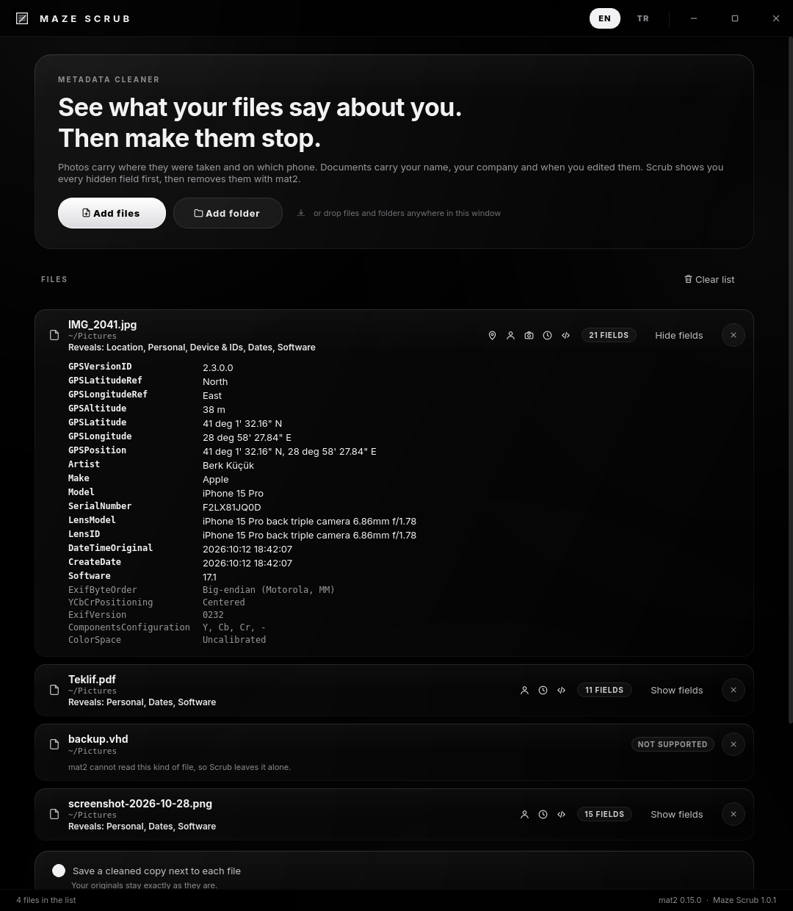
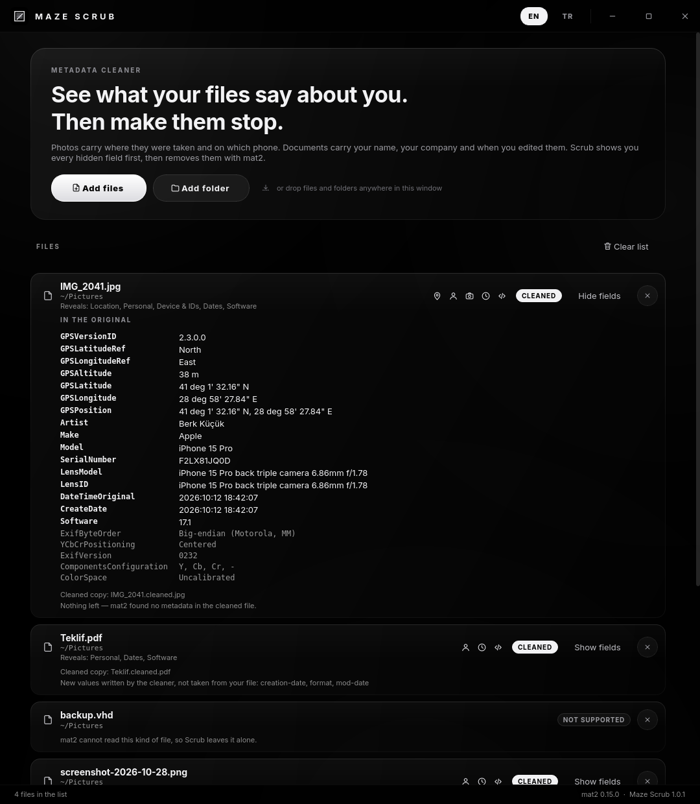
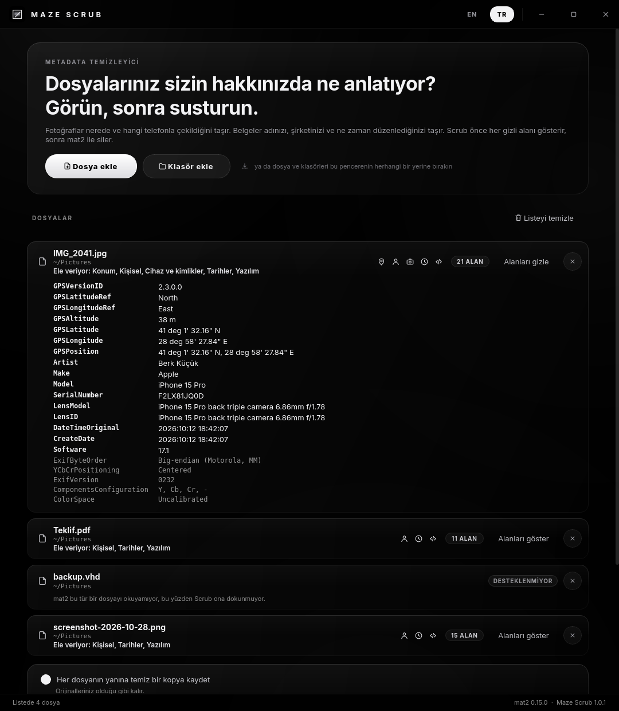

<div align="center">


# Maze Scrub

**See what your files say about you. Then make them stop.**

*Metadata cleaner for Maze Linux, built on [mat2](https://0xacab.org/jvoisin/mat2)*

</div>

---



A photo carries the GPS position it was taken at, the phone model and its serial number. A document carries your name, your company and every time you edited it. Maze Scrub shows you all of it **first**, grouped by what it gives away, and then removes it.

## What it does

- **Shows before it removes.** Every field mat2 can read, with the ones that identify you marked: **Location**, **Personal**, **Device & IDs**, **Dates**, **Software**.
- **Never loses an original.** By default it writes `photo.cleaned.jpg` next to `photo.jpg`. In *Replace the originals* mode each original goes to the **Trash** (restorable from Dolphin), and only after the cleaned file has been written and re-read. If anything goes wrong on the way — the Trash refuses, the file changed while it was being cleaned — the original stays where it was and the cleaned copy sits beside it.
- **Verifies instead of trusting.** Every cleaned file is read again. Anything still carrying the original's value is listed as a warning; values the cleaner wrote itself (a re-drawn PDF gets a new creation date and PDF version) are listed separately, so they are not mistaken for a failed clean.
- **Handles big folders.** Results appear file by file as they are read, up to four mat2 processes run side by side (about 35 photos a second on a laptop), and **Stop** ends a run at once — files already done keep their results. Closing the window stops the helpers too; nothing keeps running in the background.
- **Right-click in Dolphin** → *Remove metadata*, on files or whole folders. A second right-click while the window is open adds to the same window.
- **Command line** for scripts and other Maze apps:

  ```bash
  maze-scrub --show photo.jpg                 # what it reveals
  maze-scrub --clean photo.jpg                # → photo.cleaned.jpg
  maze-scrub --clean --replace ~/Pictures/x   # in place, originals to the Trash
  maze-scrub --clean --json file.pdf          # machine-readable, exit 0 = all clean
  ```

| | |
|---|---|
|  |  |

Supported formats are mat2's: JPEG, PNG, TIFF, HEIC, WebP, GIF, PDF, Office and LibreOffice documents, EPUB, audio (MP3, FLAC, OGG…), video with ffmpeg, archives, and more.

## What it cannot do

Said up front, and in the app:

- It removes data **about** a file, not what is **in** it: faces, a street sign, a reflection or a name written in a document stay visible.
- PDFs are re-drawn as images to remove everything, so their text can no longer be selected (unless *Lightweight mode* is on).
- Images are re-saved, which can slightly change JPEG quality.
- A file can still identify you in other ways: writing style, camera sensor noise, the account you send it from.

## Install

On Maze Linux:

```bash
sudo pacman -S maze-scrub
```

mat2 and everything it needs (exiftool, mutagen, poppler) come with it as dependencies.

### Build from source

```bash
./build-pkg.sh
sudo pacman -U dist-pkg/maze-scrub-*-any.pkg.tar.zst
```

The script runs the tests, builds the package and stops; it never installs and never asks for a password. `pacman -U` pulls in mat2 from the Arch repositories.

## How it works

mat2 is built for the system Python with GObject, Cairo and Poppler bindings; Maze apps run on the shared `/opt/maze/venv`. So the app never imports libmat2: `mazescrub/helper/mat2_helper.py` runs under `/usr/bin/python3 -I`, receives one JSON request on stdin (paths inside the JSON, never as arguments) and answers with one JSON line per file the moment that file is done. Output is ASCII-escaped, so file names that are not valid UTF-8 work too. exiftool and ffmpeg run inside bubblewrap when it is installed.

Files are sent to the helpers in chunks of 40. A helper that stays silent for two minutes is killed and only its own files are marked as failed; a stopped clean deletes any half-written output, so a `.cleaned` file on disk is always a finished one.

No root, no service, no network.

## Tests

```bash
QT_QPA_PLATFORM=offscreen /opt/maze/venv/bin/python3 -m unittest discover -s tests -v
```

The helper runs for real under the system Python against a stand-in libmat2 (`tests/fake_libmat2`), so the protocol, the Trash, stopping mid-run and every "never lose the original" path are exercised. With mat2 installed, a real JPEG is also cleaned and re-checked. `./build-pkg.sh` runs the same suite before it builds.

## License

Copyright © 2026 Berk Küçük — GPL3, see [LICENSE](LICENSE).
